# Thang M. Pham's personal website

An engineering-first profile built on al-folio and Jekyll, with selected research supporting the senior MLE narrative. The homepage, web CV, and metadata describe the current role; internal work details should never be added without clearance for public release.

## Maintaining this site

- Homepage and featured research: `_pages/about.md`; news: `_news/`; publications: `_bibliography/papers.bib`.
- Homepage order is hero, conceptual workflow, engineering focus and approach, experience/background with timeline, selected research, news, then patent applications. The workflow is the visual centerpiece immediately below the introduction. Lead with engineering scope and judgment, with research as supporting evidence; keep featured-paper descriptions grounded in the published findings rather than unsupported personal ownership or production-impact claims.
- Update both `_data/cv.yml` and `assets/json/resume.json` when experience changes. The theme can render either format.
- Homepage and CV publications are curated selections, not copies of the complete bibliography. Papers excluded from those selections can remain in the full publication list and news.
- Patent applications are separate from publications and granted patents. `_data/patents.yml` supplies the homepage and YAML CV; mirror those entries in the JSON resume's custom `patents` section. Only generic topics and pending status are cleared for this site; do not add exact invention titles, application numbers, filing dates, screenshots, or technical details without separate public-disclosure clearance.
- Verify publication metadata against publisher or DOI records. Use the online publication date for dated milestones, distinguish it from a later print year, and update existing preprint entries to the published version rather than creating duplicate papers. Keep featured-paper links, CV entries, and news consistent.
- The old CV PDF link is disabled until an updated PDF is available. Replace `assets/pdf/CV_Thang.pdf`, then set `cv_pdf` in `_pages/cv.md`.
- Demo posts/pages are excluded in `_config.yml`, not deleted. External demo feeds and blog archives are disabled. To publish original writing, enable the blog and only the original posts you intend to expose.
- Visual styling lives in `_sass/_profile.scss`. Preserve light/dark themes and keyboard/mobile usability.
- Keep motion restrained: `assets/js/common.js` reveals below-the-fold homepage sections once without hiding content beforehand. The decorative SVG in `_includes/model-core.liquid` fills the right-hand hero column: a point-cloud model core, tool orbits, and an outer harness boundary. Its 12-second cycle sends a token into the core, highlights internal connections, visits a tool, and emits a result. It is a conceptual metaphor, not actual model internals, private architecture, or a runtime schedule. Motion pauses off-screen and in hidden tabs. Reduced motion retains static line art and disables packets, activation pulses, reveals, card lifts, link transitions, and workflow fades.
- Homepage social links share a full-width row below the hero copy and illustration, wrapping on smaller screens. Keep visible text alongside decorative icons; Google Scholar uses `scholar_userid` from `_config.yml`.
- Keep the model-core illustration in its own desktop column to the right of the hero copy, scaling to the column width without overlapping text or the portrait, blur, or pointer interactions. Hide it at 991px and below. The portrait sits to the left of the name and tagline; keep its responsive image sizes aligned with the CSS (112px desktop, 96px at 991px and below, 72px at 575px and below), sharp and unobstructed. Keep the portrait and `og_image` aligned when changing the photo; the current crop uses the banner-free original. Homepage model-scope copy and conceptual workflow descriptions should not imply private architectures, persistent memory, or unverified production controls.
- The homepage "Engineering focus & approach" section uses three concise principles from `approach` in `_pages/about.md`, with small decorative line-art emblems rather than illustrated topic cards. Research panels use lightweight SVG illustrations in `_includes/profile-visual.liquid`; their content and the career timeline are also maintained in `_pages/about.md`. Illustrations are conceptual, not measured evaluation results or product screenshots. Research artwork responds to card hover on fine pointers and keyboard focus with short CSS-only highlights and transitions, never autoplay loops or extra tab stops. Reduced motion disables SVG movement and transitions while retaining instant highlights. Section accents and timeline details stay non-interactive and free of additional labels or animation.
- The compact general-purpose AI workbench in `_includes/document-intelligence.liquid` is driven by `assets/js/document-intelligence.js`. The figure is the only stage selector; it explains task inputs, agent/harness support, optional retrieval, tools/reasoning, provenance where relevant, and evaluation. Results include answers, summaries, analyses, and actions, not only document Q&A. The workflow illustrates common public patterns, not an employer's internal architecture; steps vary by task. Keep the diagram top-aligned, with short labels and no sidebar expanders. Each stage has a title and one-sentence explanation to the right at viewport widths of 1200px and above, or below the figure on smaller screens, without a separate walkthrough heading or example demo. It makes no model/API calls. A harness is execution support, not another coordinating agent; tools are capabilities, not invented autonomous agents. Evaluation represents dimensions to inspect, not a runtime gate or benchmark results. The diagram scrolls internally on narrow screens with hidden scrollbars and usable touch/keyboard navigation. Motion starts automatically with a short cue on stage selection, respects reduced-motion preferences, and pauses off-screen or in hidden tabs. Keep explanations usable without JavaScript; never add private names, routing rules, prompts, configurations, unpublished inventions, or unsupported ownership/performance claims.

The workbench uses a wide, shallow figure (1000 by 335 SVG units, capped at 800 CSS pixels) with explanations in a 13rem right column on wide screens and below on smaller screens. Homepage name/tagline sizes cap at 48px/28px with a 16px root; the tagline wraps naturally rather than forcing two lines. Animated input, context, result, provenance, and trace tokens replace running dots. Stage highlights and explanations transition over 240ms without moving the diagram's nodes. The upper layer illustrates task coordination, working context, and harness-backed model/tool execution; it is not a fixed production topology. Vector symbols illustrate structured context, not actual embeddings or a private retrieval implementation. Its presentation loop advances every 5.2 seconds through inputs, coordination, retrieval, tools/reasoning, provenance, and evaluation; clicking a stage restarts there. There is no playback button; hidden-tab, off-screen, and reduced-motion states stop progression. This is a teaching sequence, not an exact runtime schedule. Decorative background dots and unlabelled activity bars are omitted.

Arrows terminate at explicit nodes. Solid arrows show task flow; dashed arrows show source queries, context return to task agents, or evaluation observations. Keep task requests in the inputs node rather than duplicating them as a separate question.

## Analytics

The broken ClustrMaps globe has been removed. Standard Google Analytics 4 is the free dashboard used by this site. The existing measurement ID is retained in `_config.yml`; confirm it belongs to a property you control.

Production builds load GA4 only after visitor consent. Local development does not load analytics. Advertising signals are disabled. The privacy page allows changing the choice. Other optional analytics providers remain disabled; enabling them requires a separate privacy/consent review.

After deployment:

1. In [Google Analytics](https://analytics.google.com/), open **Admin > Data streams > Web**. Confirm the stream URL is `https://thangpm.github.io` and the measurement ID matches `_config.yml`. If you cannot access the property, create a new free GA4 property and replace the ID.
2. Visit the deployed site without an ad blocker, allow analytics, and check **Realtime** for your visit. Standard reports may take 24-48 hours.
3. Use demographic details for country/region/city and acquisition reports for referrals. Names, professions, and employers cannot be inferred reliably and are not collected. Consent, blockers, VPNs, and reporting thresholds limit the data.
4. Use the privacy page to decline and confirm subsequent navigation does not load `gtag/js`. Do not send personal information through analytics events or URLs.

## Validation and deployment

Use Ruby 3.3 (CI follows its latest patch release to support updated Ubuntu runner images), Bundler from `Gemfile.lock`, and Node for the existing Prettier checks:

```sh
bundle install
JEKYLL_ENV=production bundle exec jekyll build
node --test bin/analytics-consent.test.cjs
node --test bin/document-intelligence.test.cjs
npx prettier --check _pages/about.md _layouts/about.liquid _sass/_profile.scss assets/js/analytics-consent.js
```

The deploy workflow publishes `_site` to `gh-pages` on a push to `main`/`master`; GitHub Pages must serve that branch. Confirm Actions is enabled and the deploy run succeeds. Run PurgeCSS as CI does before final visual checks. Verify home, CV, publications, news, privacy, theme switching, and mobile navigation. Validate consent using a production build served locally; use development builds for ordinary previews.

## Remaining content updates

- Supply an updated downloadable CV and the confirmed end date of the 2024 internship (currently shown as the year only).
- Check publications for post-2024 venue/status updates and add approved public work.
- Add a current location only if desired; the stale Auburn location is no longer shown.
- Configure Google Search Console verification if search indexing/reporting is wanted.
- Review inherited workflows and external publication/repository badge services before enabling unused theme features.
- The inherited Sass imports and some dependency APIs emit deprecation warnings. Plan a tested upstream theme/dependency refresh separately rather than upgrading the whole stack as part of a visual change.

## Upstream theme

The original al-folio documentation follows.

# al-folio

<div align="center">

[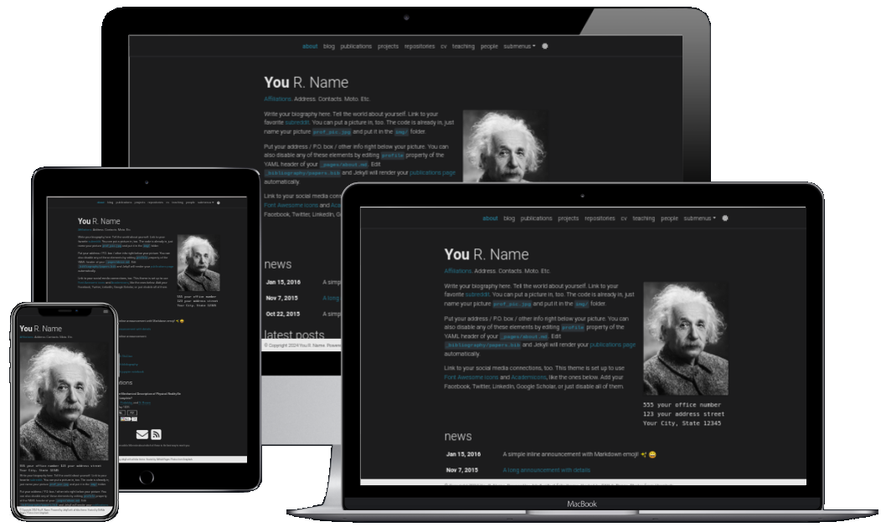](https://alshedivat.github.io/al-folio/)

**A simple, clean, and responsive [Jekyll](https://jekyllrb.com/) theme for academics.**

---

[](https://github.com/alshedivat/al-folio/actions/workflows/deploy.yml)
[](#maintainers)
[](https://github.com/alshedivat/al-folio/graphs/contributors/)
[](https://hub.docker.com/r/amirpourmand/al-folio)
[](https://hub.docker.com/r/amirpourmand/al-folio)
[](https://hub.docker.com/r/amirpourmand/al-folio)

[](https://github.com/alshedivat/al-folio/releases/latest)
[](https://github.com/alshedivat/al-folio/blob/main/LICENSE)
[](https://github.com/alshedivat/al-folio)
[](https://github.com/alshedivat/al-folio/fork)

</div>

## User community

The vibrant community of **al-folio** users is growing!
Academics around the world use this theme for their homepages, blogs, lab pages, as well as webpages for courses, workshops, conferences, meetups, and more.
Check out the community webpages below.
Feel free to add your own page(s) by sending a PR.

<table>
<tr>
<td>Academics</td>
<td>
<a href="https://martinbulla.github.io" target="_blank">★</a>
<a href="https://maruan.alshedivat.com" target="_blank">★</a>
<a href="https://www.cs.columbia.edu/~chen1ru/" target="_blank">★</a>
<a href="https://maithraraghu.com" target="_blank">★</a>
<a href="https://platanios.org" target="_blank">★</a>
<a href="https://otiliastr.github.io" target="_blank">★</a>
<a href="https://www.maths.dur.ac.uk/~sxwc62/" target="_blank">★</a>
<a href="https://jessachandler.com/" target="_blank">★</a>
<a href="https://mayankm96.github.io/" target="_blank">★</a>
<a href="https://markdean.info/" target="_blank">★</a>
<a href="https://kakodkar.github.io/" target="_blank">★</a>
<a href="https://sahirbhatnagar.com/" target="_blank">★</a>
<a href="https://spd.gr/" target="_blank">★</a>
<a href="https://jay-sarkar.github.io/" target="_blank">★</a>
<a href="https://aborowska.github.io/" target="_blank">★</a>
<a href="https://aditisgh.github.io/" target="_blank">★</a>
<a href="https://alexhaydock.co.uk/" target="_blank">★</a>
<a href="https://alixkeener.net/" target="_blank">★</a>
<a href="https://andreea7b.github.io/" target="_blank">★</a>
<a href="https://rishabhjoshi.github.io/" target="_blank">★</a>
<a href="https://sheelabhadra.github.io/" target="_blank">★</a>
<a href="https://giograno.me/" target="_blank">★</a>
<a href="https://immsrini.github.io/" target="_blank">★</a>
<a href="https://apooladian.github.io/" target="_blank">★</a>
<a href="https://chinmoy-dutta.github.io/" target="_blank">★</a>
<a href="https://liamcli.com/" target="_blank">★</a>
<a href="https://yoonholee.com/" target="_blank">★</a>
<a href="https://zrqiao.github.io/" target="_blank">★</a>
<a href="https://abstractgeek.github.io/" target="_blank">★</a>
<a href="https://www.compphys.de/" target="_blank">★</a>
<a href="https://julianstreyczek.github.io" target="_blank">★</a>
<a href="https://sdaza.com" target="_blank">★</a>
<a href="https://niweera.gq" target="_blank">★</a>
<a href="https://www.alihkw.com" target="_blank">★</a>
<a href="https://amirpourmand.ir" target="_blank">★</a>
<a href="https://scottleechua.github.io" target="_blank">★</a>
<a href="https://sk1y101.github.io" target="_blank">★</a>
<a href="https://yyang768osu.github.io" target="_blank">★</a>
<a href="https://veedata.github.io" target="_blank">★</a>
<a href="https://K-Wu.github.io" target="_blank">★</a>
<a href="https://amalawilson.com" target="_blank">★</a>
<a href="https://tirtharajdash.github.io" target="_blank">★</a>
<a href="https://carolinacarreira.github.io" target="_blank">★</a>
<a href="https://manandey.github.io" target="_blank">★</a>
<a href="https://johanneshoerner.github.io" target="_blank">★</a>
<a href="https://ioannismavromatis.com" target="_blank">★</a>
<a href="https://taidnguyen.github.io" target="_blank">★</a>
<a href="https://lbugnon.github.io" target="_blank">★</a>
<a href="https://joahannes.github.io" target="_blank">★</a>
<a href="https://dominikstrb.github.io" target="_blank">★</a>
<a href="https://tylerbarna.com" target="_blank">★</a>
<a href="https://daviddmc.github.io/" target="_blank">★</a>
<a href="https://andreaskuster.ch/" target="_blank">★</a>
<a href="https://ellisbrown.github.io/" target="_blank">★</a>
<a href="https://noman-bashir.github.io/" target="_blank">★</a>
<a href="https://djherron.github.io/" target="_blank">★</a>
<a href="https://rodosingh.github.io/" target="_blank">★</a>
<a href="https://vdivakar.github.io/" target="_blank">★</a>
<a href="https://george-gca.github.io/" target="_blank">★</a>
<a href="https://bashirkazimi.github.io/" target="_blank">★</a>
<a href="https://dohaison.github.io/" target="_blank">★</a>
<a href="https://raphaaal.github.io/" target="_blank">★</a>
<a href="https://varuniyer.info/" target="_blank">★</a>
<a href="https://yukimasano.github.io/" target="_blank">★</a>
<a href="https://hashe037.github.io/" target="_blank">★</a>
<a href="https://wang-boyu.github.io/" target="_blank">★</a>
<a href="https://qingqingchen.info" target="_blank">★</a>
<a href="https://bajinsheng.github.io/" target="_blank">★</a>
<a href="https://www.silviofanzon.com/" target="_blank">★</a>
<a href="https://kaikaiyao.github.io/" target="_blank">★</a>
<a href="https://alchemz.github.io/" target="_blank">★</a>
<a href="https://samadamday.com/" target="_blank">★</a>
<a href="https://fanpu.io/" target="_blank">★</a>
<a href="https://abigalekim.github.io/" target="_blank">★</a>
<a href="https://lucasresck.github.io/" target="_blank">★</a>
<a href="https://users.wpi.edu/~lfichera/" target="_blank">★</a>
<a href="https://anmspro.github.io/" target="_blank">★</a>
<a href="https://berlyne.net/" target="_blank">★</a>
<a href="https://filippomazzoli.github.io/" target="_blank">★</a>
<a href="https://www.escontrela.me/" target="_blank">★</a>
<a href="https://raffaem.github.io/" target="_blank">★</a>
<a href="https://cbueth.de/" target="_blank">★</a>
<a href="https://kyleaoman.github.io/" target="_blank">★</a>
<a href="https://decwest.github.io/" target="_blank">★</a>
<a href="https://www.jedburkat.com" target="_blank">★</a>
<a href="https://hrzhang.me" target="_blank">★</a>
<a href="https://kudhru.github.io/" target="_blank">★</a>
<a href="https://mbarbetti.github.io/" target="_blank">★</a>
<a href="https://www.zhivotenko.com/" target="_blank">★</a>
<a href="https://giordanodaloisio.github.io/" target="_blank">★</a>
<a href="https://aadityaura.github.io/" target="_blank">★</a>
<a href="https://abhinav-mehta.github.io/" target="_blank">★</a>
<a href="https://shubhashisroydipta.com/" target="_blank">★</a>
<a href="https://astanziola.github.io" target="_blank">★</a>
<a href="https://tinkerer.in" target="_blank">★</a>
<a href="https://sam-bieberich.github.io/" target="_blank">★</a>
<a href="https://afraniomelo.github.io/en/" target="_blank">★</a>
<a href="https://jonaruthardt.github.io" target="_blank">★</a>
<a href="https://www.zla.app/" target="_blank">★</a>
<a href="https://stavros.github.io" target="_blank">★</a>
<a href="https://ericslyman.com" target="_blank">★</a>
<a href="https://ztjona.github.io/" target="_blank">★</a>
<a href="https://chrischoi314.github.io" target="_blank">★</a>
<a href="https://riccobelli.faculty.polimi.it" target="_blank">★</a>
<a href="https://kishanved.tech/" target="_blank">★</a>
<a href="https://abhilesh.github.io/" target="_blank">★</a>
<a href="https://jackjburnett.github.io/" target="_blank">★</a>
<a href="https://physics-morris.github.io/" target="_blank">★</a>
<a href="https://sraf.ir" target="_blank">★</a>
<a href="https://acad.garywei.dev/" target="_blank">★</a>
<a href="https://tonideleo.github.io/" target="_blank">★</a>
<a href="https://alonkellner.com/" target="_blank">★</a>
<a href="https://berylbir.github.io/" target="_blank">★</a>
<a href="https://thefermi0n.github.io/" target="_blank">★</a>
<a href="https://mingsun-kaust.github.io/" target="_blank">★</a>
<a href="https://hdocmsu.github.io/" target="_blank">★</a>
<a href="https://trandangtrungduc.github.io/" target="_blank">★</a>
<a href="https://kinghowler.github.io/" target="_blank">★</a>
<a href="https://anurye.github.io/" target="_blank">★</a>
<a href="https://charlie-xiao.github.io/" target="_blank">★</a>
<a href="https://giuseppeperelli.github.io/" target="_blank">★</a>
<a href="https://shlee-lab.github.io/" target="_blank">★</a>
<a href="https://devos50.github.io/" target="_blank">★</a>
<a href="https://kocikowski.com/" target="_blank">★</a>
<a href="https://vmooers.github.io/" target="_blank">★</a>
<a href="https://jpfonseca.github.io/" target="_blank">★</a>
<a href="https://dmitryryumin.github.io/" target="_blank">★</a>
</td>
</tr>
<tr>
<td>Labs</td>
<td>
<a href="https://www.haylab.caltech.edu/" target="_blank">★</a>
<a href="https://sjkimlab.github.io/" target="_blank">★</a>
<a href="https://systemconsultantgroup.github.io/scg-folio/" target="_blank">★</a>
<a href="https://decisionlab.ucsf.edu/" target="_blank">★</a>
<a href="https://programming-group.com/" target="_blank">★</a>
<a href="https://sailing-lab.github.io/" target="_blank">★</a>
<a href="https://inbt.jhu.edu/epidiagnostics/" target="_blank">★</a>
<a href="https://www.nuesl.org/" target="_blank">★</a>
<a href="https://big-culture.github.io/" target="_blank">★</a>
</td>
</tr>
<tr>
<td>Courses</td>
<td>
CMU PGM (<a href="https://sailinglab.github.io/pgm-spring-2019/" target="_blank">S-19</a>) <br>
CMU DeepRL (<a href="https://cmudeeprl.github.io/403_website/" target="_blank">S-21</a>, <a href="https://cmudeeprl.github.io/703website_f21/" target="_blank">F-21</a>, <a href="https://cmudeeprl.github.io/403website_s22/" target="_blank">S-22</a>, <a href="https://cmudeeprl.github.io/703website_f22/" target="_blank">F-22</a>, <a href="https://cmudeeprl.github.io/403website_s23/" target="_blank">S-23</a>, <a href="https://cmudeeprl.github.io/703website_f23/" target="_blank">F-23</a>) <br>
CMU MMML (<a href="https://cmu-multicomp-lab.github.io/mmml-course/fall2020/" target="_blank">F-20</a>, <a href="https://cmu-multicomp-lab.github.io/mmml-course/fall2022/" target="_blank">F-22</a>) <br>
CMU AMMML (<a href="https://cmu-multicomp-lab.github.io/adv-mmml-course/spring2022/" target="_blank">S-22</a>, <a href="https://cmu-multicomp-lab.github.io/adv-mmml-course/spring2023/" target="_blank">S-23</a>) <br>
CMU ASI (<a href="https://cmu-multicomp-lab.github.io/asi-course/spring2023/" target="_blank">S-23</a>) <br>
CMU Distributed Systems (<a href="https://andrew.cmu.edu/course/15-440/" target="_blank">S-24</a>)
</td>
</tr>
<tr>
<td>Conferences & workshops</td>
<td>
ICLR Blog Post Track (<a href="https://iclr-blogposts.github.io/2023/" target="_blank">2023</a>, <a href="https://iclr-blogposts.github.io/2024/about" target="_blank">2024</a>) <br>
ML Retrospectives (NeurIPS: <a href="https://ml-retrospectives.github.io/neurips2019/" target="_blank">2019</a>, <a href="https://ml-retrospectives.github.io/neurips2020/" target="_blank">2020</a>; ICML: <a href="https://ml-retrospectives.github.io/icml2020/" target="_blank">2020</a>) <br>
HAMLETS (NeurIPS: <a href="https://hamlets-workshop.github.io/" target="_blank">2020</a>) <br>
ICBINB (NeurIPS: <a href="https://i-cant-believe-its-not-better.github.io/" target="_blank">2020</a>, <a href="https://i-cant-believe-its-not-better.github.io/neurips2021/" target="_blank">2021</a>) <br>
Neural Compression (ICLR: <a href="https://neuralcompression.github.io/" target="_blank">2021</a>) <br>
Score Based Methods (NeurIPS: <a href="https://score-based-methods-workshop.github.io/" target="_blank">2022</a>)<br>
Images2Symbols (CogSci: <a href="https://images2symbols.github.io/" target="_blank"> 2022</a>) <br>
Medical Robotics Junior Faculty Forum (ISMR: <a href="https://junior-forum-ismr.github.io/" target="_blank"> 2023</a>)<br>
Beyond Vision: Physics meets AI (ICIAP: <a href="https://physicsmeetsai.github.io/beyond-vision/" target="_blank">2023</a>) <br>
Workshop on Diffusion Models (NeurIPS: <a href="https://diffusionworkshop.github.io/" target="_blank">2023</a>) <br>
Workshop on Structured Probabilistic Inference & Generative Modeling (ICML: <a href="https://spigmworkshop.github.io/" target="_blank">2023</a>, <a href="https://spigmworkshop2024.github.io/" target="_blank">2024</a>)
</td>
</tr>
</table>

## Lighthouse PageSpeed Insights

### Desktop

[](https://htmlpreview.github.io/?https://github.com/alshedivat/al-folio/blob/main/lighthouse_results/desktop/alshedivat_github_io_al_folio_.html)

Run the test yourself: [Google Lighthouse PageSpeed Insights](https://pagespeed.web.dev/report?url=https%3A%2F%2Falshedivat.github.io%2Fal-folio%2F&form_factor=desktop)

### Mobile

[](https://htmlpreview.github.io/?https://github.com/alshedivat/al-folio/blob/main/lighthouse_results/mobile/alshedivat_github_io_al_folio_.html)

Run the test yourself: [Google Lighthouse PageSpeed Insights](https://pagespeed.web.dev/report?url=https%3A%2F%2Falshedivat.github.io%2Fal-folio%2F&form_factor=mobile)

## Table Of Contents

- [al-folio](#al-folio)
  - [User community](#user-community)
  - [Lighthouse PageSpeed Insights](#lighthouse-pagespeed-insights)
    - [Desktop](#desktop)
    - [Mobile](#mobile)
  - [Table Of Contents](#table-of-contents)
  - [Getting started](#getting-started)
  - [Installing and Deploying](#installing-and-deploying)
  - [Customizing](#customizing)
  - [Features](#features)
    - [Light/Dark Mode](#lightdark-mode)
    - [CV](#cv)
    - [People](#people)
    - [Publications](#publications)
    - [Collections](#collections)
    - [Layouts](#layouts)
      - [The iconic style of Distill](#the-iconic-style-of-distill)
      - [Full support for math \& code](#full-support-for-math--code)
      - [Photos, Audio, Video and more](#photos-audio-video-and-more)
    - [Other features](#other-features)
      - [GitHub's repositories and user stats](#githubs-repositories-and-user-stats)
      - [Theming](#theming)
      - [Social media previews](#social-media-previews)
      - [Atom (RSS-like) Feed](#atom-rss-like-feed)
      - [Related posts](#related-posts)
      - [Code quality checks](#code-quality-checks)
  - [FAQ](#faq)
  - [Contributing](#contributing)
    - [Maintainers](#maintainers)
    - [All Contributors](#all-contributors)
  - [Star History](#star-history)
  - [License](#license)

## Getting started

Want to learn more about Jekyll? Check out [this tutorial](https://www.taniarascia.com/make-a-static-website-with-jekyll/). Why Jekyll? Read [Andrej Karpathy's blog post](https://karpathy.github.io/2014/07/01/switching-to-jekyll/)! Why write a blog? Read [Rachel Thomas blog post](https://medium.com/@racheltho/why-you-yes-you-should-blog-7d2544ac1045).

## Installing and Deploying

For installation and deployment details please refer to [INSTALL.md](INSTALL.md).

## Customizing

For customization details please refer to [CUSTOMIZE.md](CUSTOMIZE.md).

## Features

### Light/Dark Mode

This template has a built-in light/dark mode. It detects the user preferred color scheme and automatically switches to it. You can also manually switch between light and dark mode by clicking on the sun/moon icon in the top right corner of the page.

<p align="center">
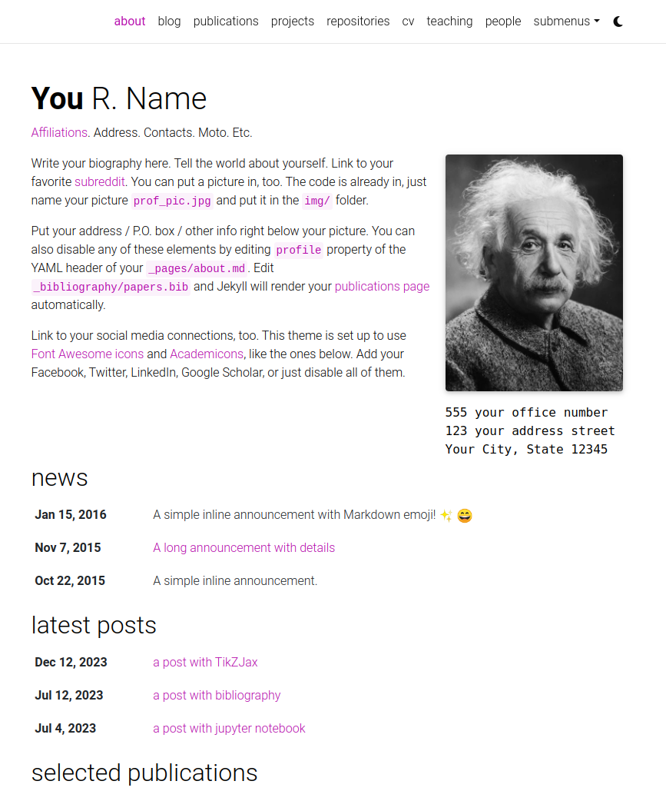
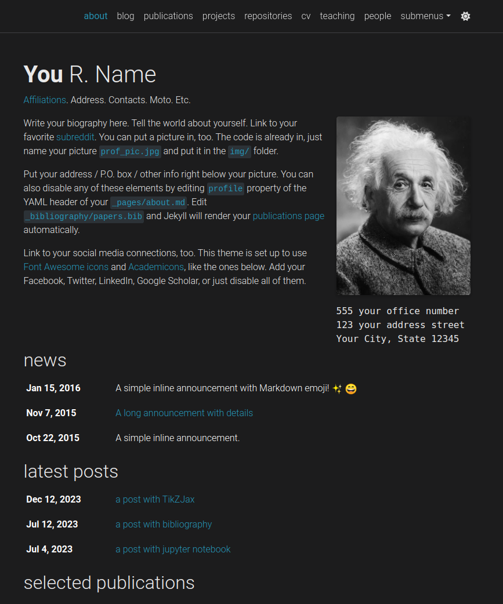
</p>

---

### CV

There are currently 2 different ways of generating the CV page content. The first one is by using a json file located in [assets/json/resume.json](assets/json/resume.json). It is a [known standard](https://jsonresume.org/) for creating a CV programmatically. The second one, currently used as a fallback when the json file is not found, is by using a yml file located in [\_data/cv.yml](_data/cv.yml). This was the original way of creating the CV page content and since it is more human readable than a json file we decided to keep it as an option.

What this means is, if there is no resume data defined in [\_config.yml](_config.yml) and loaded via a json file, it will load the contents of [\_data/cv.yml](_data/cv.yml) as fallback.

[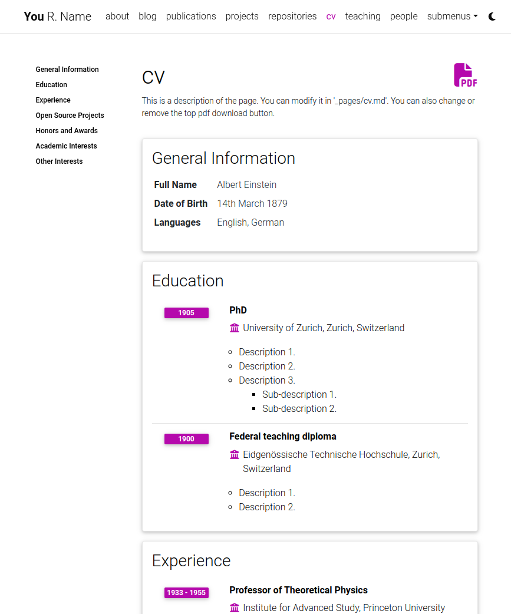](https://alshedivat.github.io/al-folio/cv/)

---

### People

You can create a people page if you want to feature more than one person. Each person can have its own short bio, profile picture, and you can also set if every person will appear at the same or opposite sides.

[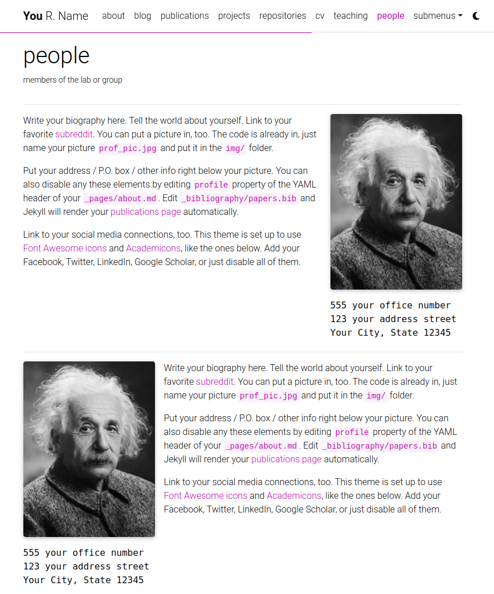](https://alshedivat.github.io/al-folio/people/)

---

### Publications

Your publications' page is generated automatically from your BibTex bibliography. Simply edit [\_bibliography/papers.bib](_bibliography/papers.bib). You can also add new `*.bib` files and customize the look of your publications however you like by editing [\_pages/publications.md](_pages/publications.md). By default, the publications will be sorted by year and the most recent will be displayed first. You can change this behavior and more in the `Jekyll Scholar` section in [\_config.yml](_config.yml) file.

You can add extra information to a publication, like a PDF file in the [assets/pdf/](assets/pdf/) directory and add the path to the PDF file in the BibTeX entry with the `pdf` field. Some of the supported fields are: `abstract`, `altmetric`, `arxiv`, `bibtex_show`, `blog`, `code`, `dimensions`, `doi`, `eprint`, `html`, `isbn`, `pdf`, `pmid`, `poster`, `slides`, `supp`, `video`, and `website`.

[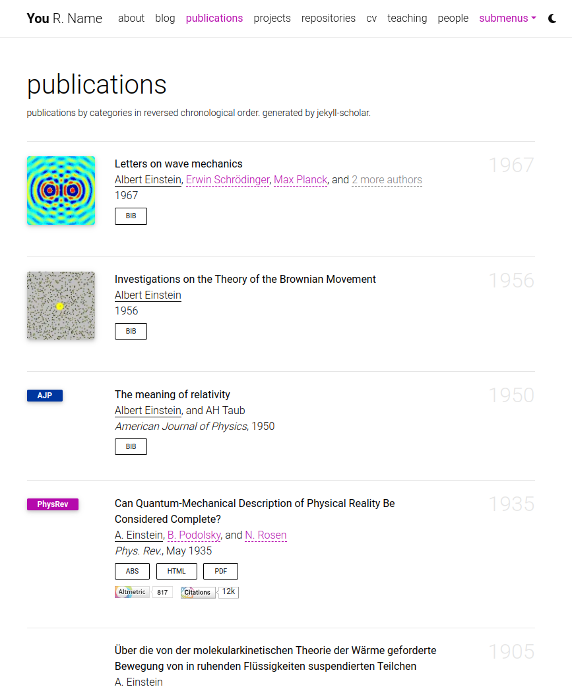](https://alshedivat.github.io/al-folio/publications/)

---

### Collections

This Jekyll theme implements `collections` to let you break up your work into categories. The theme comes with two default collections: `news` and `projects`. Items from the `news` collection are automatically displayed on the home page. Items from the `projects` collection are displayed on a responsive grid on projects page.

[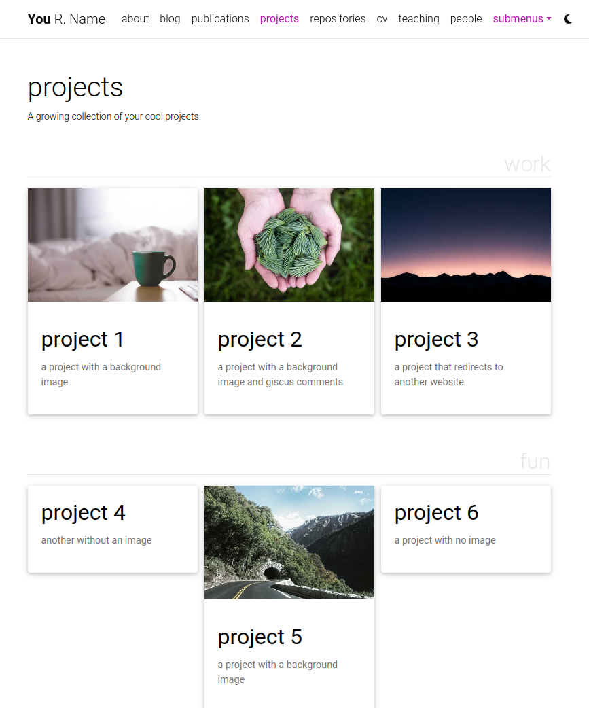](https://alshedivat.github.io/al-folio/projects/)

You can easily create your own collections, apps, short stories, courses, or whatever your creative work is. To do this, edit the collections in the [\_config.yml](_config.yml) file, create a corresponding folder, and create a landing page for your collection, similar to `_pages/projects.md`.

---

### Layouts

**al-folio** comes with stylish layouts for pages and blog posts.

#### The iconic style of Distill

The theme allows you to create blog posts in the [distill.pub](https://distill.pub/) style:

[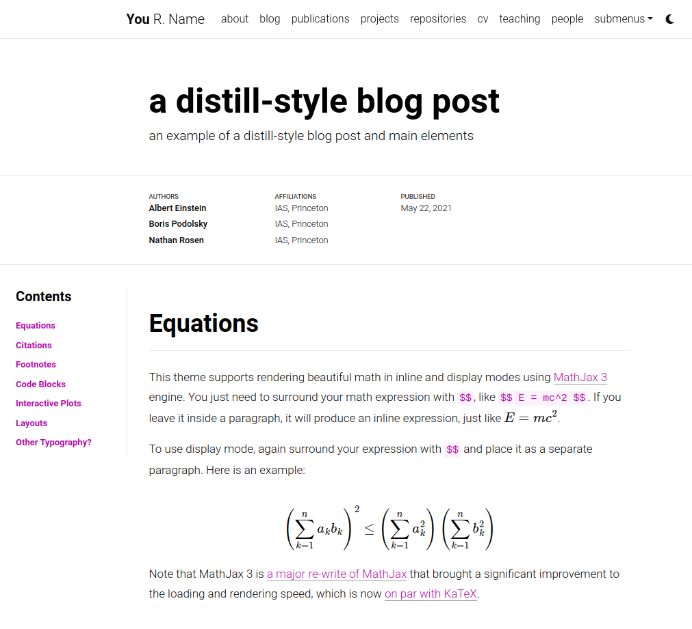](https://alshedivat.github.io/al-folio/blog/2021/distill/)

For more details on how to create distill-styled posts using `<d-*>` tags, please refer to [the example](https://alshedivat.github.io/al-folio/blog/2021/distill/).

#### Full support for math & code

**al-folio** supports fast math typesetting through [MathJax](https://www.mathjax.org/) and code syntax highlighting using [GitHub style](https://github.com/jwarby/jekyll-pygments-themes). Also supports [chartjs charts](https://www.chartjs.org/), [mermaid diagrams](https://mermaid-js.github.io/mermaid/#/), and [TikZ figures](https://tikzjax.com/).

<p align="center">
<a href="https://alshedivat.github.io/al-folio/blog/2015/math/" target="_blank">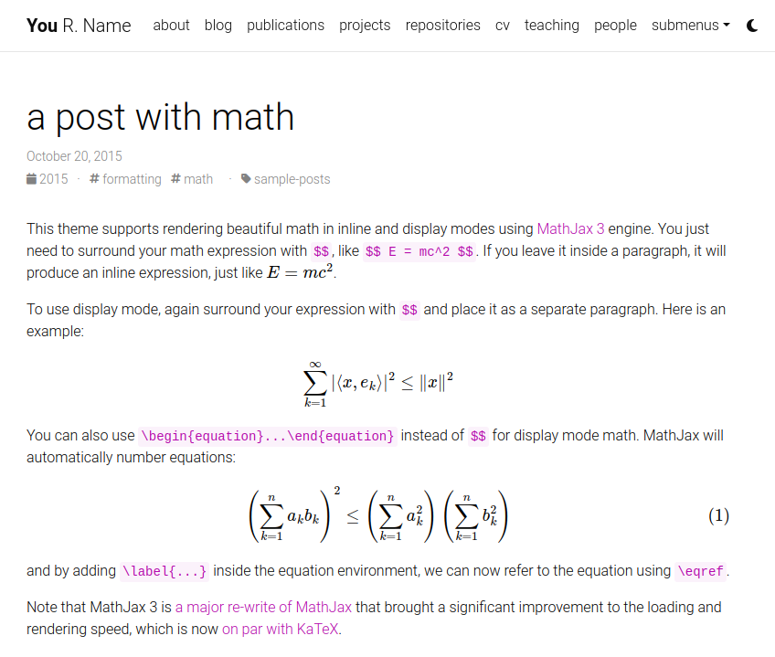</a>
<a href="https://alshedivat.github.io/al-folio/blog/2015/code/" target="_blank">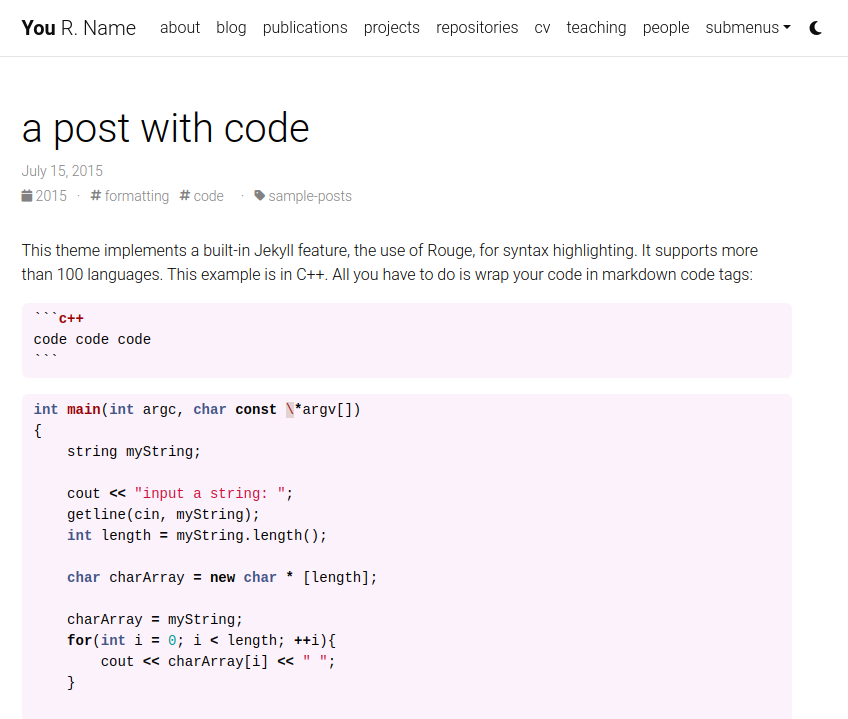</a>
</p>

#### Photos, Audio, Video and more

Photo formatting is made simple using [Bootstrap's grid system](https://getbootstrap.com/docs/4.4/layout/grid/). Easily create beautiful grids within your blog posts and project pages, also with support for [video](https://alshedivat.github.io/al-folio/blog/2023/videos/) and [audio](https://alshedivat.github.io/al-folio/blog/2023/audios/) embeds:

<p align="center">
  <a href="https://alshedivat.github.io/al-folio/projects/1_project/">
    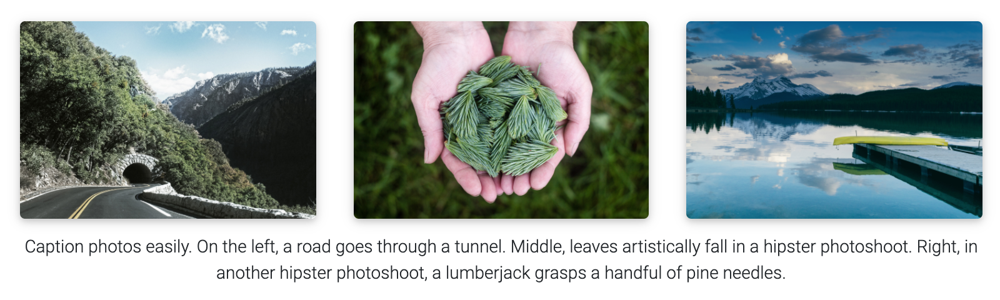
  </a>
</p>

---

### Other features

#### GitHub's repositories and user stats

**al-folio** uses [github-readme-stats](https://github.com/anuraghazra/github-readme-stats) and [github-profile-trophy](https://github.com/ryo-ma/github-profile-trophy) to display GitHub repositories and user stats on the `/repositories/` page.

[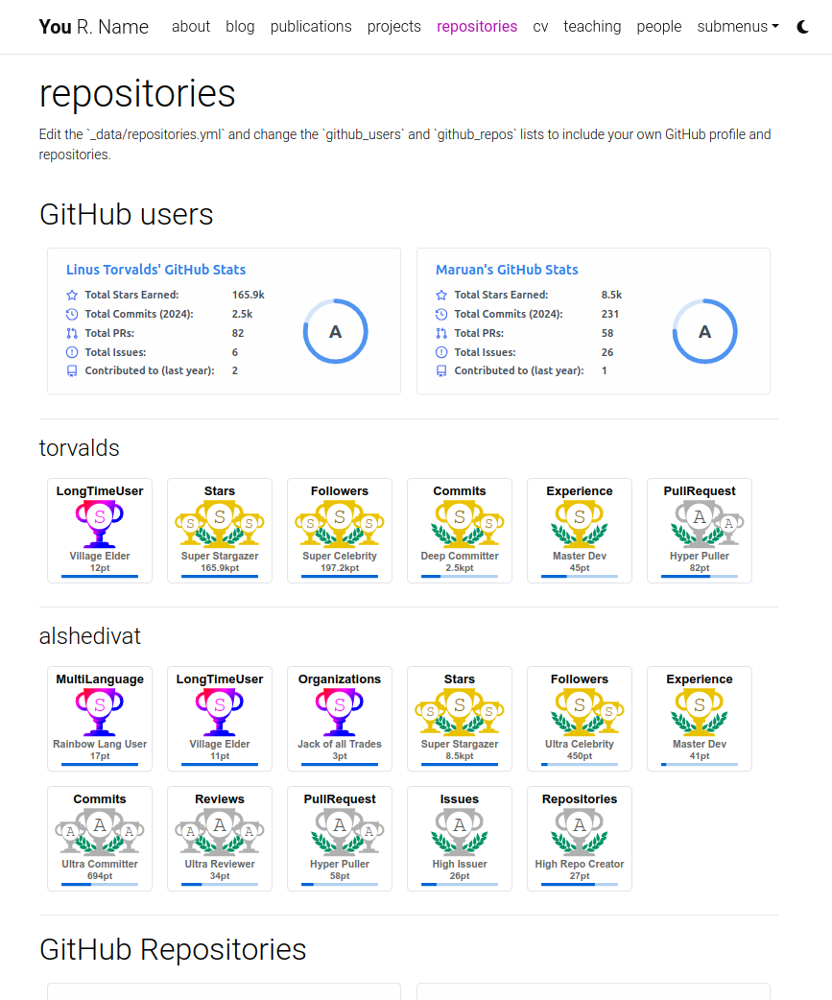](https://alshedivat.github.io/al-folio/repositories/)

Edit the `_data/repositories.yml` and change the `github_users` and `github_repos` lists to include your own GitHub profile and repositories to the `/repositories/` page.

You may also use the following codes for displaying this in any other pages.

```html
<!-- code for GitHub users -->

<div class="repositories d-flex flex-wrap flex-md-row flex-column justify-content-between align-items-center">
    
</div>


<!-- code for GitHub trophies -->
  
<h4>{{ user }}</h4>

<div class="repositories d-flex flex-wrap flex-md-row flex-column justify-content-between align-items-center">
  
</div>
 

<!-- code for GitHub repositories -->

<div class="repositories d-flex flex-wrap flex-md-row flex-column justify-content-between align-items-center">
    
</div>

```

---

#### Theming

A variety of beautiful theme colors have been selected for you to choose from. The default is purple, but you can quickly change it by editing the `--global-theme-color` variable in the `_sass/_themes.scss` file. Other color variables are listed there as well. The stock theme color options available can be found at [\_sass/\_variables.scss](_sass/_variables.scss). You can also add your own colors to this file assigning each a name for ease of use across the template.

---

#### Social media previews

**al-folio** supports preview images on social media. To enable this functionality you will need to set `serve_og_meta` to `true` in your [\_config.yml](_config.yml). Once you have done so, all your site's pages will include Open Graph data in the HTML head element.

You will then need to configure what image to display in your site's social media previews. This can be configured on a per-page basis, by setting the `og_image` page variable. If for an individual page this variable is not set, then the theme will fall back to a site-wide `og_image` variable, configurable in your [\_config.yml](_config.yml). In both the page-specific and site-wide cases, the `og_image` variable needs to hold the URL for the image you wish to display in social media previews.

---

#### Atom (RSS-like) Feed

It generates an Atom (RSS-like) feed of your posts, useful for Atom and RSS readers. The feed is reachable simply by typing after your homepage `/feed.xml`. E.g. assuming your website mountpoint is the main folder, you can type `yourusername.github.io/feed.xml`

---

#### Related posts

By default, there will be a related posts section on the bottom of the blog posts. These are generated by selecting the `max_related` most recent posts that share at least `min_common_tags` tags with the current post. If you do not want to display related posts on a specific post, simply add `related_posts: false` to the front matter of the post. If you want to disable it for all posts, simply set `enabled` to false in the `related_blog_posts` section in [\_config.yml](_config.yml).

---

#### Code quality checks

Currently, we run some checks to ensure that the code quality and generated site are good. The checks are done using GitHub Actions and the following tools:

- [Prettier](https://prettier.io/) - check if the formatting of the code follows the style guide
- [lychee](https://lychee.cli.rs/) - check for broken links
- [Axe](https://github.com/dequelabs/axe-core) (need to run manually) - do some accessibility testing

We decided to keep `Axe` runs manual because fixing the issues are not straightforward and might be hard for people without web development knowledge.

## FAQ

For frequently asked questions, please refer to [FAQ.md](FAQ.md).

## Contributing

Contributions to al-folio are very welcome! Before you get started, please take a look at [the guidelines](CONTRIBUTING.md).

If you would like to improve documentation or fix a minor inconsistency or bug, please feel free to send a PR directly to `main`. For more complex issues/bugs or feature requests, please open an issue using the appropriate template.

### Maintainers

Our most active contributors are welcome to join the maintainers team. If you are interested, please reach out!

<!-- ALL-CONTRIBUTORS-LIST:START - Do not remove or modify this section -->
<!-- prettier-ignore-start -->
<!-- markdownlint-disable -->
<table>
  <tbody>
    <tr>
      <td align="center" valign="top" width="14.28%"><a href="http://maruan.alshedivat.com"><br /><sub><b>Maruan</b></sub></a></td>
      <td align="center" valign="top" width="14.28%"><a href="http://rohandebsarkar.github.io"><br /><sub><b>Rohan Deb Sarkar</b></sub></a></td>
      <td align="center" valign="top" width="14.28%"><a href="https://amirpourmand.ir"><br /><sub><b>Amir Pourmand</b></sub></a></td>
      <td align="center" valign="top" width="14.28%"><a href="https://george-gca.github.io/"><br /><sub><b>George</b></sub></a></td>
    </tr>
  </tbody>
</table>

<!-- markdownlint-restore -->
<!-- prettier-ignore-end -->

<!-- ALL-CONTRIBUTORS-LIST:END -->

### All Contributors

<a href="https://contrib.rocks">
  
</a>

## Star History

<a href="https://star-history.com/#alshedivat/al-folio&Date">
  <picture>
    <source media="(prefers-color-scheme: dark)" srcset="https://api.star-history.com/svg?repos=alshedivat/al-folio&type=Date&theme=dark" />
    <source media="(prefers-color-scheme: light)" srcset="https://api.star-history.com/svg?repos=alshedivat/al-folio&type=Date" />
    
  </picture>
</a>

## License

The theme is available as open source under the terms of the [MIT License](https://github.com/alshedivat/al-folio/blob/main/LICENSE).

Originally, **al-folio** was based on the [\*folio theme](https://github.com/bogoli/-folio) (published by [Lia Bogoev](https://liabogoev.com) and under the MIT license). Since then, it got a full re-write of the styles and many additional cool features.
